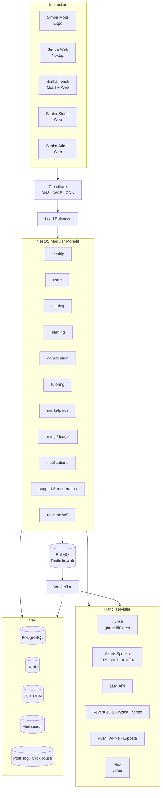

# Simba — Teknik Altyapı Mimarisi (v0.1)

> Görsel versiyon: [`docs/architecture.html`](architecture.html) · Öğrenci arayüzü demosu: [`demo/index.html`](../demo/index.html)

Simba; oyunlaştırılmış dil öğrenme (Duolingo tarzı), canlı öğretmenle birebir ders (Cambly tarzı) ve içerik üreticilerin kurs satıp para kazandığı bir pazar yerini tek platformda birleştirir. Hedef diller ilk aşamada **İngilizce, Çince, Rusça, Fransızca**; kaynak dil Türkçe.

---

## 1. Ürünler ve kullanıcılar

| Uygulama | Kim kullanır | Platform | Ana işlevler |
|---|---|---|---|
| **Simba** (öğrenci) | Öğrenciler | iOS, Android, Web | Ders yolu, egzersizler, tekrar (hatalar), lig/görev/seri, öğretmenle ders, creator kursları, Premium |
| **Simba Teach** | Öğretmenler | iOS, Android, Web | Başvuru & profil, uygunluk takvimi, rezervasyonlar, “Şimdi Görüş” kuyruğu, görüntülü ders, ders notu, kazanç & ödeme |
| **Simba Studio** | İçerik üreticiler + iç içerik ekibi | Web | Kurs/ünite/ders/egzersiz editörü, medya yükleme, önizleme, inceleme süreci, satış & gelir paneli |
| **Simba Admin** | Admin, destek, moderatör, finans | Web (ayrı domain) | Kullanıcı yönetimi, destek talepleri, moderasyon, içerik onayı, öğretmen onayı, ödemeler/iadeler, raporlar, sistem ayarları |

Öğrenci ve öğretmen mobil uygulamaları **mağazada iki ayrı uygulama** olarak yayınlanır (Cambly / Cambly Tutor modeli): bildirimler, izinler ve mağaza incelemeleri birbirine karışmaz. İkisi de aynı paylaşılan paketlerden derlenir.

---

## 2. Temel kararlar

1. **Uçtan uca TypeScript.** Web, mobil ve backend aynı dili konuşur; API tipleri, egzersiz değerlendirme mantığı ve tasarım token’ları paylaşılır. Küçük ekip için en büyük hız kazancı budur.
2. **Monorepo** — Turborepo + pnpm. Altı uygulama + ortak paketler tek repoda.
3. **Mobil: React Native + Expo** (EAS Build, EAS Update ile OTA güncelleme). Ses kaydı, push, offline ders paketleri, kamera/mikrofon (görüntülü ders) Expo ekosisteminde hazır.
4. **Web: Next.js (App Router).** Öğrenci web’i aynı zamanda SEO’lu pazarlama sitesi. Teach, Studio ve Admin ayrı Next.js uygulamaları — ayrı domain, ayrı güvenlik politikası, ayrı deploy.
5. **Backend: NestJS modüler monolit.** Başta tek deploy; modül sınırları ve veritabanı şemaları ayrı tutulur. Yükü ayrışan parçalar (realtime, medya işleme, analitik) sonradan ayrı servise çıkarılır. Mikroservisle başlamak bu ölçekte maliyetli ve yavaştır.
6. **Veri:** PostgreSQL (ana kaynak), Redis (cache, lig sıralamaları, rate-limit, kuyruk), S3 uyumlu obje depolama + CDN (ses, görsel, video).
7. **Görüntülü ders:** WebRTC medya sunucusu yazılmaz — **LiveKit** (Cloud ile başla, maliyet büyürse self-host). Kayıt için LiveKit Egress.
8. **Ses teknolojileri:** **Azure AI Speech** — TTS (doğal sesler), STT ve telaffuz değerlendirme; dört hedef dili de destekler.
9. **Yapay zekâ:** LLM (ör. Claude) — AI sohbet partneri, “neden yanlış?” açıklamaları, serbest cevap değerlendirme, Studio’da egzersiz üretim asistanı.
10. **Ödeme:** Mobil dijital satışlar App Store / Google Play IAP (RevenueCat ile tek API), web’de iyzico (TR) + Stripe (global). Öğretmen ve creator kazançları iç **muhasebe defterinde (ledger)** tutulur, dönemsel payout yapılır.

---

## 3. Sistem diyagramı



---

## 4. Backend modülleri

| Modül | Sorumluluk | Notlar |
|---|---|---|
| `identity` | Kayıt/giriş, Google & Apple ile giriş, JWT (kısa ömürlü access + dönen refresh), RBAC | Roller: `learner`, `teacher`, `creator`, `support`, `content_editor`, `finance`, `admin`. Admin rollerinde 2FA zorunlu. |
| `users` | Profil, takip/arkadaş, ayarlar, ülke/saat dilimi | KVKK/GDPR: veri dışa aktarma ve hesap silme uçları. |
| `catalog` | Kurs → Ünite → Seviye → Ders → Egzersiz; medya | Kurs = (kaynak dil, hedef dil) çifti. Egzersiz `type + payload(jsonb)`, JSON Schema ile doğrulanır, versiyonlanır. Taslak → İnceleme → Yayın. |
| `learning` | Ders oturumu, cevap değerlendirme, ilerleme, can/seri/XP | Aralıklı tekrar **FSRS** algoritmasıyla (“Ekstra Çalışma: hatalı cümlelerini tekrar et”). Offline cevaplar idempotent event olarak senkronlanır. |
| `gamification` | Haftalık ligler, günlük görevler, rozetler, elmas ekonomisi | Lig grupları ~30 kişi, Redis sorted set; hafta sonu terfi/düşme worker’la. |
| `tutoring` | Öğretmen başvurusu & onayı, uygunluk takvimi, rezervasyon, anlık eşleşme, ders oturumu, değerlendirme | Tüm saatler UTC saklanır, gösterimde kullanıcı saat dilimi. LiveKit oda token’ını bu modül üretir. İptal/gelmeme kuralları. |
| `marketplace` | Creator kursları, fiyat, erişim (entitlement), yorum/puan | Creator içeriği aynı `catalog` modelini kullanır, `owner_type = creator`. |
| `billing` | Abonelik, ders kredisi paketleri, kurs satışı, iade, payout | Store/RevenueCat/iyzico/Stripe webhook’ları. **Çift kayıtlı ledger**; bakiye hiçbir zaman tek sütunda tutulmaz. TR e-Arşiv fatura entegrasyonu. |
| `notifications` | Push, e-posta, uygulama içi bildirim | Seri hatırlatma kullanıcının yerel saatine göre zamanlanır. |
| `support` | Destek talepleri, uygulama içi destek sohbeti, kullanıcıyı salt-okunur görüntüleme | Admin’in yaptığı her işlem `audit_log`’a yazılır. |
| `moderation` | Kullanıcı/içerik şikayetleri, ders sohbeti raporları, otomatik filtre | Creator içerik incelemesi buradan geçer. |
| `realtime` | WebSocket gateway: sohbet, öğretmen çevrimiçi durumu, canlı bildirim | Yatay ölçek için Redis adapter; ileride ayrı servis. |
| `analytics` | Ürün event’leri, A/B test, tutunma (retention) | PostHog (ürün analitiği + feature flag), ileride ClickHouse/BigQuery. |

API: **REST + OpenAPI**; istemci SDK’sı OpenAPI’den otomatik üretilir (`packages/api-client`). Gerçek zamanlı ihtiyaçlar WebSocket üzerinden.

---

## 5. Dile özel gereksinimler

- **Çince:** Hanzi, pinyin ve ton ayrı alanlarda saklanır. Karakter yazma egzersizi (Hanzi Writer + stroke-order verisi), ton telaffuz puanlaması, cevap kontrolünde kelime bölme.
- **Rusça:** Kiril ekran klavyesi, transliterasyon ipucu, vurgu işaretleri (ударение), hâl çekimi egzersizleri.
- **Fransızca:** Aksan toleransı (é ↔ e) ayarlanabilir, liaison içeren sesler.
- **İngilizce:** US / UK aksan seçimi.
- **Genel:** Cevap normalizasyonu (Unicode NFC, noktalama, büyük/küçük harf), birden fazla doğru cevap, Levenshtein ile yazım toleransı.
- **Arayüz dilleri:** Türkçe ile başla; i18n altyapısı ilk günden (EN, RU, Türkmence eklenebilir).

---

## 6. Çekirdek veri modeli

```
users ─┬─ user_roles, profiles, follows, devices
       ├─ enrollments ── lesson_progress ── attempts
       ├─ review_items            (FSRS: stability, difficulty, due_at)
       ├─ streaks, gem_transactions, league_memberships, quest_progress, achievements
       ├─ subscriptions, purchases, entitlements
       └─ tickets ── ticket_messages

courses (source_lang, target_lang, owner_type, creator_id, status, price)
  └─ units ── lessons ── exercises (type, payload jsonb, version)
media_assets (s3_key, kind, duration, transcoding_status)

teacher_profiles ── availability_rules ── bookings ── sessions (livekit_room, recording_key) ── reviews
creator_profiles ── payout_accounts

ledger_accounts ── ledger_entries (double-entry)  ── payouts
audit_logs, reports
```

---

## 7. Para akışları

| Gelir kaynağı | Nasıl satılır | Kim kazanır |
|---|---|---|
| **Simba Premium** (aylık/yıllık) | Mobilde IAP (RevenueCat), web’de iyzico/Stripe | Platform; bir kısmı creator havuzuna ayrılır |
| **Öğretmen dersleri** (kredi/paket) | Web + mobil | Öğretmen ders başı hak ediş (ör. %75), platform komisyonu |
| **Creator kursları** | Tekil satış veya “Premium’a dahil” | Satışta ör. %70 creator; Premium havuzunda tamamlanan ders süresine göre pay |

- Kazançlar ledger’a **bekleyen** olarak düşer, iade süresi (ör. 14 gün) dolunca **kullanılabilir** olur, aylık payout ile ödenir (Stripe Connect; desteklenmeyen ülkelerde Payoneer/Wise).
- App Store, birebir canlı insan hizmetleri için uygulama dışı ödemeye izin verir (Guideline 3.1.3(d)); öğretmen paketleri bu kapsamda değerlendirilebilir. Dijital içerik (Premium, creator kursları) mobilde IAP gerektirir. Güncel mağaza kuralları ve vergi tarafı lansmandan önce hukuken doğrulanmalı.

---

## 8. Altyapı ve DevOps

| Alan | Seçim |
|---|---|
| Bulut | AWS `eu-central-1` (Frankfurt) — Türkiye’ye düşük gecikme |
| Backend çalıştırma | ECS Fargate (API, worker’lar). Kubernetes ihtiyaç doğana kadar ertelenir |
| Web uygulamaları | Vercel (Next.js) |
| Veritabanı / cache | RDS PostgreSQL (Multi-AZ), ElastiCache Redis |
| Medya | S3 + CloudFront; creator videoları için Mux (yükleme, HLS, oynatıcı) |
| Arama | Meilisearch (öğretmen ve kurs arama, Türkçe/Çince destekli) |
| Edge | Cloudflare (DNS, WAF, DDoS) |
| IaC & CI/CD | Terraform, GitHub Actions, Expo EAS Build/Submit/Update |
| Gözlemlenebilirlik | Sentry (hata), OpenTelemetry + Grafana Cloud (metrik/log/trace), PostHog |

**Güvenlik ve uyum**
- Admin paneli ayrı domain, SSO + 2FA, IP kısıtı; tüm işlemler audit log’da.
- KVKK: yurtdışı veri aktarımı için açık rıza/aydınlatma metni; hassas alanlar şifreli.
- 13 yaş altı kullanıcı için ebeveyn onayı; öğretmen derslerinde şikayet akışı ve (onaylı) kayıt.
- Öğretmen başvurularında kimlik doğrulama (KYC) ve demo ders değerlendirmesi.

---

## 9. Monorepo yapısı

```
simba/
├─ apps/
│  ├─ mobile/          # Simba öğrenci uygulaması (Expo)
│  ├─ mobile-teach/    # Simba Teach (Expo)
│  ├─ web/             # Öğrenci web + pazarlama (Next.js)
│  ├─ teach/           # Öğretmen web (Next.js)
│  ├─ studio/          # İçerik üretici paneli (Next.js)
│  ├─ admin/           # Admin & destek paneli (Next.js)
│  ├─ api/             # NestJS modüler monolit
│  └─ worker/          # BullMQ job’ları (lig, bildirim, payout, medya)
├─ packages/
│  ├─ ui/              # Tasarım token’ları + ortak bileşenler (NativeWind/Tailwind)
│  ├─ exercise-engine/ # Egzersiz tipleri, render + değerlendirme mantığı (web & mobil ortak)
│  ├─ api-client/      # OpenAPI’den üretilen tipli istemci
│  ├─ i18n/            # Arayüz çevirileri
│  └─ config/          # eslint, tsconfig, tailwind preset
└─ infra/              # Terraform
```

---

## 10. Yol haritası

| Faz | Süre (tahmini) | Kapsam |
|---|---|---|
| **0 — Temel** | 2–3 hafta | Tasarım sistemi, monorepo, CI/CD, kimlik doğrulama, ortamlar |
| **1 — MVP** | ~3 ay | Öğrenci mobil + web, egzersiz motoru (4 dili destekler), İngilizce A1 içeriği, can/seri/görev/lig, Premium, Admin v1 (kullanıcı + destek), Studio v0 (iç içerik ekibi) |
| **2 — Öğretmenler** | ~2 ay | Simba Teach mobil + web, takvim & rezervasyon, “Şimdi Görüş”, LiveKit görüntülü ders, kredi paketleri, öğretmen payout |
| **3 — Creator pazarı** | ~2 ay | Studio dış üreticilere açılır, inceleme akışı, kurs satışı, Premium havuzu, creator payout |
| **4 — Genişleme** | sürekli | Çince, Rusça, Fransızca içerikleri (Faz 1’den itibaren paralel üretilir), AI sohbet partneri, telaffuz puanlama |

**MVP ekibi önerisi:** 1 tech lead (backend), 1 backend, 2 TypeScript frontend (RN + Next.js), 1 UI/UX tasarımcı, yarı zamanlı QA, dil başına 1 içerik editörü.
