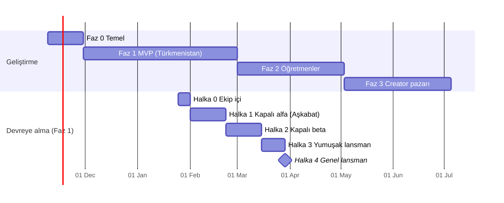

# Simba — Geliştirme ve Devreye Alma Planı (v0.1)

> Mimari: [`docs/ARCHITECTURE.md`](ARCHITECTURE.md) · Bu belge, mimarideki [yol haritasını](ARCHITECTURE.md#11-yol-haritası) iş paketlerine, sprintlere, ortamlara ve yayın adımlarına böler.

**Varsayımlar:** Ekip, mimarideki MVP ekibi önerisiyle kurulur (tech lead + 1 backend, 2 frontend, 1 tasarımcı, yarı zamanlı QA, içerik editörleri, Aşkabat’ta yerel ortak). Sprintler 2 haftalıktır. Takvim **9 Kasım 2026 (H1)** başlangıcına göre tahminidir; ekip tam kadro başlamazsa veya yılbaşı tatili düşülürse 1–2 hafta kayar.

---

## 1. Genel bakış

İki ayrı eksen var:

- **Geliştirme fazları** — ne inşa ediliyor (Faz 0–4).
- **Devreye alma halkaları** — inşa edilen şey kime, hangi sırayla açılıyor (Halka 0–4). Her faz kendi halkalarından geçer; bir halkadan sonrakine yalnızca o halkanın **çıkış kriterleri** karşılanınca geçilir.

| Faz | Haftalar | Tarih (tahmini) | Sonuç |
|---|---|---|---|
| **0 — Temel** | H1–H3 | 9 Kas – 27 Kas 2026 | Çalışan iskelet: monorepo, CI/CD, 3 ortam, giriş, i18n |
| **1 — MVP (Türkmenistan)** | H4–H16 | 30 Kas 2026 – 26 Şub 2027 | Öğrenci uygulaması + Premium/aktivasyon kodu + Admin v1 + Studio v0 |
| ↳ Lansman | H16–H21 | 22 Şub – 29 Mar 2027 | Kapalı beta → yumuşak lansman → genel lansman |
| **2 — Öğretmenler** | H17–H25 | 1 Mar – 30 Nis 2027 | Simba Teach, rezervasyon, görüntülü ders, ders kredisi |
| **3 — Creator pazarı** | H26–H34 | 3 May – 2 Tem 2027 | Studio dış üreticilere açık, kurs satışı, creator payout |
| **4 — Genişleme** | H35+ | Temmuz 2027 → | Yeni kurslar, yeni ülkeler, AI özellikleri |

Faz 2, Faz 1 lansmanıyla üst üste biner: lansman ve sonrasındaki yoğun destek süresi (hypercare) boyunca ekibin bir kısmı Faz 1’de kalır, diğerleri Faz 2’ye geçer.

---

## 2. Ortamlar ve teslim hattı

### 2.1 Ortamlar

| Ortam | Amaç | Altyapı | Veri | Kim erişir |
|---|---|---|---|---|
| `local` | Geliştirme | Docker Compose (Postgres, Redis, Meilisearch, MinIO) | Seed verisi | Geliştirici |
| `preview` | PR başına önizleme | Vercel preview (web uygulamaları), EAS Update `preview` kanalı (mobil) → paylaşılan `dev` API | Seed | Ekip, tasarımcı, editör |
| `dev` | `main`’in sürekli kurulumu | AWS ayrı hesap, küçük boyutlu ECS + RDS | Seed + sentetik | Ekip |
| `staging` | Üretimin kopyası; sürüm adayı testi, yük testi, Aşkabat ağ testi | AWS, üretimle aynı Terraform modülleri, küçük boyut | Anonimleştirilmiş üretim kopyası (lansmandan sonra); öncesinde gerçek içerik | Ekip, QA, yerel test kullanıcıları |
| `prod` | Canlı | AWS `eu-central-1`, Multi-AZ | Gerçek | Kullanıcılar; ekipten yalnızca yetkili roller |

- Her ortam ayrı AWS hesabında (AWS Organizations); `prod` erişimi SSO + MFA, kısa ömürlü yetki.
- Ödeme sağlayıcıları ve SMS: `dev`/`staging` sandbox anahtarlarıyla; `prod` anahtarları yalnızca `prod` hesabının Secrets Manager’ında.
- Üçüncü taraf istekleri tüm ortamlarda kendi proxy’mizden geçer (mimari 6.4), böylece engelleme sorunları `staging`’de yakalanır.

### 2.2 Dal ve sürüm modeli

- **Trunk-based:** Kısa ömürlü özellik dalları → `main`’e PR. Yarım işler **feature flag** (PostHog) arkasında `main`’e girer.
- PR kapısı: lint, tip kontrolü, birim testleri, `exercise-engine` değerlendirme testleri, i18n eksik anahtar kontrolü, OpenAPI farkı (kırıcı değişiklik uyarısı), migration kontrolü.
- `main` → `dev` otomatik kurulur.
- Sürüm adayı: `release/YYYY.MM.N` etiketi → `staging`. QA onayı + manuel onay (GitHub Environments) → `prod`.
- Backend ve web haftalık sürüm treni; acil düzeltmeler (hotfix) her zaman.

### 2.3 Bileşen bazında kurulum

| Bileşen | Kurulum yöntemi | Geri alma |
|---|---|---|
| `api`, `worker` | Docker imajı → ECR → ECS rolling/blue-green (CodeDeploy) | Önceki task definition’a dönüş (< 5 dk) |
| `web`, `teach`, `studio`, `admin` | Vercel; `staging` ve `prod` ayrı projeler | Vercel “instant rollback” |
| Mobil (JS değişikliği) | EAS Update, kanal başına (`preview`, `staging`, `production`); önce %10 kullanıcıya | Önceki update’i yeniden yayınlama |
| Mobil (native değişiklik) | EAS Build → Play Console / App Store Connect; Play’de kademeli yayın %10 → %50 → %100; APK sitemizde | Kademeli yayını durdurma; zorunlu güncelleme sürümü |
| Veritabanı | Migration’lar kurulumdan önce ayrı adım olarak; **expand → migrate → contract** (geriye uyumlu) | Geri alma yerine ileri düzeltme; PITR yedeği |
| Altyapı | Terraform plan PR’da yorum olarak, apply onayla | Önceki state/commit |
| İçerik | Studio’da Taslak → İnceleme → Yayın; ders paketleri versiyonlu | Önceki içerik versiyonunu yayınlama |

**Mobil sürüm politikası:** Uygulama açılışta `min_supported_version` ve `latest_version` bilgisini API’den alır. Eski sürüm desteklenmiyorsa zorunlu güncelleme ekranı (Play / App Store / APK bağlantısı). API en az son iki mobil sürümle geriye uyumlu tutulur.

### 2.4 Gözlemlenebilirlik ve hedefler (SLO)

| Gösterge | Hedef |
|---|---|
| API erişilebilirliği | %99,5 (aylık) |
| API p95 gecikme (Frankfurt’tan) | < 300 ms; Aşkabat’tan ölçülen p95 < 800 ms |
| Çökmesiz oturum (mobil) | ≥ %99,5 |
| SMS OTP teslimi (+993) | ≥ %95, ortalama < 30 sn |
| Ders tamamlama hatası (sunucu kaynaklı) | < %0,5 |
| Aktivasyon kodu kullanım başarısı | ≥ %99 (geçerli kodlarda) |

Sentry, Grafana Cloud ve PostHog panoları; SLO ihlalinde nöbetçiye uyarı. Lansmandan itibaren haftalık nöbet çizelgesi ve her kritik akış için runbook (SMS gecikmesi, ödeme webhook hatası, kod kullanım hatası, CDN engeli, veritabanı yük artışı).

---

## 3. Geliştirme fazları

### Faz 0 — Temel (H1–H3)

**Amaç:** Özellik geliştirmeye başlamadan önce herkesin aynı hat üzerinde çalışması: koddan `prod`’a kadar boş ama çalışan bir uygulama.

| İş paketi | Teslimat |
|---|---|
| Monorepo | Turborepo + pnpm, `apps/*` ve `packages/*` iskeleti (mimari §10), ortak eslint/tsconfig |
| Altyapı | Terraform: AWS hesapları, VPC, ECS, RDS, ElastiCache, S3 + CloudFront, Cloudflare; `dev` + `staging` + `prod` |
| CI/CD | GitHub Actions hattı (§2.2), EAS projeleri ve kanalları, Vercel projeleri |
| Kimlik | Telefon + SMS OTP, JWT access/refresh, RBAC rolleri; SMS sağlayıcısının +993 teslim testi |
| i18n | `packages/i18n`, ICU MessageFormat, Türkmence tarih/sayı tabloları, Tolgee kurulumu, CI eksik anahtar kontrolü |
| Tasarım sistemi | `packages/ui` token’ları ve temel bileşenler (demo görsellerinden) |
| Gözlemlenebilirlik | Sentry, OpenTelemetry, PostHog — kendi alan adımızdaki proxy üzerinden |
| Araştırma (paralel) | Aşkabat’ta ağ ölçümü (engellenen alan adları, gecikme), yerel ödeme/bayi ortağı görüşmeleri, veri mevzuatı için hukukçu |

**Çıkış kriterleri**
- “Merhaba” ekranlı mobil uygulama bir geliştirici telefonunda SMS ile giriş yapıyor; web aynı API’yi kullanıyor.
- `main`’e birleşen değişiklik insan müdahalesi olmadan `dev`’e kuruluyor; `staging` ve `prod`’a onaylı kurulum çalışıyor.
- Aşkabat’tan `staging`’e erişim ve SMS teslimi doğrulandı (veya alternatif karar alındı).

---

### Faz 1 — MVP Türkmenistan (H4–H16)

**Amaç:** Türkmence ve Rusça konuşan öğrencinin tk→en ve ru→en A1 kursunu mobilde ve web’de oynayabilmesi, Premium’u aktivasyon koduyla açabilmesi; ekibin içerik üretip kullanıcıları ve kodları yönetebilmesi.

| Sprint | Haftalar | Kapsam |
|---|---|---|
| **S1** | H4–H5 | `catalog` veri modeli + `exercise_translations`; Studio v0 iskeleti (kurs/ünite/ders/egzersiz editörü); `exercise-engine` ilk tipler (çoktan seçmeli, kelime bankasıyla çeviri, eşleştirme); öğrenci uygulaması kabuğu ve onboarding (dil, hedef, seviye) |
| **S2** | H6–H7 | `learning`: ders oturumu, cevap değerlendirme (normalizasyon, çoklu doğru cevap, yazım toleransı), ilerleme; dinleme ve konuşma egzersizleri (Azure TTS/STT); ses için medya hattı (Opus, CDN). **İçerik üretimi başlar** |
| **S3** | H8–H9 | `gamification`: can, seri, XP, günlük görevler, haftalık ligler; `notifications`: seri hatırlatma (yerel saat), uygulama içi bildirim kutusu |
| **S4** | H10–H11 | `billing`: Premium, ülke bazlı fiyat, **aktivasyon kodları** (üretim, parti/bayi, kullanım, iptal); Admin v1: kullanıcı arama, destek talepleri, kod ve bayi yönetimi, audit log; FSRS ile “Ekstra Çalışma” |
| **S5** | H12–H13 | Offline ders paketleri ve senkron; PWA ve doğrudan APK dağıtımı, uygulama içi güncelleme kontrolü; performans ve uygulama boyutu bütçesi; **Halka 0 → Halka 1 (kapalı alfa)** |
| **S6** | H14–H15 | Alfa geri bildirimleri; içerik tamamlama; yük testi (k6), güvenlik incelemesi (OWASP ASVS L1, kod kullanımı ve OTP için rate-limit), KVKK/mevzuat metinleri. **H15 sonunda özellik dondurma** |
| **Sertleştirme** | H16 | Sürüm adayı, mağaza gönderimleri, operasyon hazırlığı (§5), **Halka 2 (kapalı beta)** başlangıcı |

**İçerik akışı (S2’den itibaren paralel):** Hedef dil kısmı bir kez üretilir → LLM ile tk ve ru taslak çeviri → anadili editör onayı → ses kaydı/TTS → QA oynanış testi → yayın. Lansman hedefi: tk→en ve ru→en için en az **A1’in ilk 4 ünitesi** (≈ 40 ders) yayında, kalan A1 üniteleri lansmandan sonra haftalık yayın.

**Çıkış kriterleri (Faz 1 bitti sayılması için)**
- Lansman içeriği anadili editörlerce onaylandı; tüm arayüz metinleri tk/ru/tr için onaylı.
- Kritik akışlar uçtan uca test edildi: SMS ile kayıt → ders → seri/XP → aktivasyon kodu → Premium; offline ders → senkron.
- Yük testi: hedef eşzamanlı kullanıcının 3 katında SLO’lar karşılanıyor.
- Açık kritik/yüksek öncelikli hata yok; güvenlik bulguları kapandı.
- Operasyon hazırlığı (§5) tamam.

---

### Faz 2 — Öğretmenler (H17–H25)

**Amaç:** Öğrencinin Türkmence/Rusça bilen veya anadili İngilizce olan öğretmenle görüntülü ders yapabilmesi.

| Sprint | Haftalar | Kapsam |
|---|---|---|
| **S7** | H17–H18 | `tutoring`: öğretmen başvurusu, KYC, demo ders değerlendirmesi, Admin’de onay akışı; öğretmen profili (konuştuğu diller, ülke) |
| **S8** | H19–H20 | Simba Teach (mobil + web): uygunluk takvimi, saat dilimleri, rezervasyon, iptal/gelmeme kuralları; öğrenci tarafında öğretmen listesi, “ana dilimi bilen” filtresi, Meilisearch |
| **S9** | H21–H22 | LiveKit ile görüntülü ders: TURN/TLS 443 yedeği, sadece ses modu, otomatik kalite düşürme, ders içi sohbet, ders notu, şikayet akışı; Aşkabat’ta gerçek ağ testi |
| **S10** | H23–H24 | “Şimdi Görüş” anlık eşleşme; ders kredisi paketleri ve kodları; ledger’da öğretmen hak edişi (bekleyen → kullanılabilir); payout (yerel ortak üzerinden toplu ödeme + Wise/Payoneer) |
| **Sertleştirme** | H25 | Yük ve ağ testi, sürüm adayı |

**Devreye alma sırası:** Önce **arz** — öğretmen başvuruları S7 sonunda açılır, Simba Teach öğretmenlere lansmandan önce dağıtılır. Sonra öğrenci tarafı: pilot (10–20 öğretmen, beta öğrencileri, flag arkasında) → tüm Premium kullanıcılar → herkes.

**Çıkış kriterleri:** Pilotta derslerin ≥ %95’i teknik sorunsuz tamamlandı (Aşkabat ağında dahil); ilk payout dönemi ledger mutabakatıyla sorunsuz kapandı; aktif öğretmen sayısı yoğun saatlerde talebi karşılıyor.

---

### Faz 3 — Creator pazarı (H26–H34)

| Sprint | Haftalar | Kapsam |
|---|---|---|
| **S11** | H26–H27 | Studio’nun dış üreticilere açılması: creator başvurusu, `owner_type = creator`, medya yükleme (Mux), önizleme |
| **S12** | H28–H29 | `moderation` üzerinden inceleme akışı, ülke içerik kuralları kontrol listesi; kurs sayfası, yorum/puan |
| **S13** | H30–H31 | `marketplace`: fiyatlama, tekil satış, entitlement; kurs kodu (Türkmenistan); mağaza IAP gereksinimleri |
| **S14** | H32–H33 | Premium havuzu (tamamlanan ders süresine göre pay), creator satış/gelir paneli, creator payout |
| **Sertleştirme** | H34 | Sürüm adayı |

**Devreye alma sırası:** Davetli 5–10 creator ile kapalı pilot (yalnızca ücretsiz ve Premium’a dahil kurslar) → ücretli satış açılır → açık başvuru.

**Çıkış kriterleri:** İnceleme süresi ≤ 5 iş günü; ilk ay gelir paylaşımı mutabakatı sorunsuz; içerik şikayeti oranı kabul edilebilir seviyede.

---

### Faz 4 — Genişleme (H35+)

Sürekli, çeyreklik planlanır. Her yeni ülke veya kurs aynı halkalardan geçer.

- **İçerik:** tk→ru, ardından Çince ve Fransızca kursları; A2 seviyeleri.
- **Ülkeler:** Özbekistan ve Kazakistan — dil (`uz`, `kk`), ödeme adaptörleri (Payme, Click, Kaspi), fiyat tablosu, yerel ortak. Her ülke için: hukuk onayı → ağ testi → kapalı beta → lansman.
- **AI:** Sohbet partneri, “neden yanlış?” açıklamaları, telaffuz puanlama — flag arkasında A/B testiyle.
- **Rusya:** Veri yerelleştirme (242-FZ) ve yaptırım uyumu nedeniyle ayrı altyapı kararı; ayrı proje olarak ele alınır.
- **Ölçek:** `realtime` ve medya işlemenin ayrı servise çıkarılması, LiveKit self-host, okuma replikaları — metriklere göre.

---

## 4. Devreye alma halkaları (Faz 1 için)

| Halka | Ne zaman | Kimler | Dağıtım | Çıkış kriterleri |
|---|---|---|---|---|
| **0 — Ekip içi** | H12 | Ekip ve aileleri (~15 kişi) | EAS `preview` kanalı, TestFlight iç test, web `staging` | Kritik akışlar sorunsuz; çökmesiz oturum ≥ %99 |
| **1 — Kapalı alfa** | H13–H15 | Aşkabat’ta yerel ortağın seçtiği 30–50 kişi (öğrenci, öğretmen, veli) | APK + TestFlight, `staging` | Ağ testi geçti (engelli alan adı yok, p95 < 800 ms); SMS teslimi ≥ %95; kullanılabilirlik bulguları kapandı |
| **2 — Kapalı beta** | H16–H18 | 500–2.000 kişi, davetle; ilk bayilerle test kodları | Play kapalı test, TestFlight dış test, APK; `prod` (beta flag’i) | Çökmesiz ≥ %99,5; D1 tutunma ≥ %35, D7 ≥ %15; kod kullanımı ≥ %99; destek talepleri kapasite içinde |
| **3 — Yumuşak lansman** | H19–H20 | Türkmenistan genel, pazarlamasız | Play kademeli %10 → %50 → %100, App Store, APK, PWA | 7 gün SLO ihlali yok; ödeme/kod mutabakatı tutuyor; destek SLA’sı tutuyor |
| **4 — Genel lansman** | H21 | Herkes + pazarlama, bayi ağı | Tam yayın | — (hypercare başlar) |

- Lansmanlar resmi tatillere (ör. Nevruz, 21–22 Mart) ve hafta sonlarına denk getirilmez; Salı–Çarşamba tercih edilir.
- **Geri dönüş kuralı:** Çıkış kriteri tutmazsa halka uzatılır, bir sonrakine geçilmez. Kritik olayda yeni kayıtlar flag ile kapatılabilir; mevcut kullanıcılar etkilenmez.
- **Hypercare:** Genel lansmandan sonra 2 hafta; günlük metrik toplantısı, hotfix öncelikli, nöbet iki kişilik.

---

## 5. Operasyon hazırlığı (her lansman öncesi kontrol listesi)

**Teknik**
- [ ] `prod` Terraform ile kuruldu; `staging` ile fark yok.
- [ ] RDS otomatik yedek + PITR açık; **geri yükleme tatbikatı** yapıldı ve süresi ölçüldü.
- [ ] Yük testi sonuçları SLO içinde; otomatik ölçekleme eşikleri ayarlı.
- [ ] Uyarılar nöbetçiye ulaşıyor (test uyarısı gönderildi); runbook’lar yazıldı.
- [ ] Geri alma her bileşen için `staging`’de denendi (§2.3).
- [ ] Gizli anahtarlar Secrets Manager’da, döndürme süreci belgeli; `prod` erişimi kısıtlı.
- [ ] Rate-limit: OTP, kod kullanımı, giriş; WAF kuralları.
- [ ] Zorunlu güncelleme mekanizması test edildi.

**Ürün ve içerik**
- [ ] Lansman içeriği yayında ve anadili editör onaylı.
- [ ] Mağaza sayfaları, ekran görüntüleri ve gizlilik bilgileri hazır; APK indirme sayfası hazır.
- [ ] Feature flag’ler lansman konumunda; kapatılacak flag listesi belli.

**İş ve hukuk**
- [ ] Yerel ortak ve bayi sözleşmeleri imzalı; ilk kod partileri üretildi ve dağıtıldı.
- [ ] Kullanım koşulları, gizlilik politikası, çerez/izin metinleri tk/ru/tr; veri mevzuatı hukukçu onaylı.
- [ ] Destek ekibi (tk + ru) eğitildi; hazır yanıtlar ve iade/kod iptal süreçleri belli.
- [ ] Finans: kod satış raporu ve ledger mutabakat süreci belli.

---

## 6. Kalite ve test stratejisi

| Seviye | Ne | Nerede |
|---|---|---|
| Birim | `exercise-engine` değerlendirme kuralları, ledger, FSRS, i18n biçimleri | Her PR |
| Entegrasyon | API modülleri + gerçek Postgres/Redis (Testcontainers), ödeme ve SMS webhook’ları (sandbox) | Her PR |
| Sözleşme | OpenAPI farkı; `api-client` derlemesi tüm uygulamalarda | Her PR |
| Uçtan uca | Web: Playwright; mobil: Maestro — kayıt, ders, kod kullanımı, offline senkron | `staging`, her sürüm adayı |
| Görsel / i18n | Üç dilde ekran görüntüsü karşılaştırması; uzun Rusça metinlerde taşma | Her sürüm adayı |
| Yük | k6 — ders oturumu, lig güncellemesi, kod kullanımı | Faz sonu ve büyük değişiklik |
| Ağ | Aşkabat’ta gerçek cihaz testi; düşük bant simülasyonu | Her faz sonu |
| Güvenlik | Bağımlılık taraması, SAST, ödeme ve kod akışlarına sızma testi | Faz 1 ve Faz 2 lansmanından önce |

**“Tamamlandı” tanımı (her iş için):** Kod incelendi; testleri var; üç dilde metinleri anahtarlı; analitik event’leri tanımlı; gerekiyorsa flag arkasında; `staging`’de doğrulandı; belgelendi.

---

## 7. Riskler ve önlemler

| Risk | Etki | Önlem | Ne zaman bilinir |
|---|---|---|---|
| Yabancı servis/alan adlarının Türkmenistan’da engellenmesi | Uygulama veya özellik çalışmaz | Tek alan adı + proxy; H3 ağ testi; alfa Aşkabat’ta | Faz 0 sonu |
| SMS’in +993’e teslim edilmemesi | Kayıt olunamaz | İki SMS sağlayıcısı, otomatik yedek; alternatif giriş | Faz 0 sonu |
| Yerel ödeme ortağı/bayi gecikmesi | Gelir başlamaz | Aktivasyon kodu modeli ortaktan bağımsız; Premium beta süresince ücretsiz | H10 |
| İçerik üretiminin yetişmemesi | Lansman kayar | S2’de başla; LLM taslak + editör onayı; lansman kapsamı 4 ünite | H12 |
| Türkmence/Rusça çeviri kalitesi | Güven kaybı | Anadili onayı zorunlu, alfa geri bildirimi | H15 |
| Görüntülü dersin düşük bantta kötü çalışması | Faz 2 değeri düşer | TURN/443, sadece ses modu, erken ağ testi (S9) | H22 |
| Mağaza/mevzuat kuralları | Mağaza reddi, ceza | Hukuk görüşü Faz 0’da; APK/PWA alternatifi | H16 |
| Küçük ekipte kişi bağımlılığı | Gecikme | Belgeleme, eşli inceleme, runbook’lar | Sürekli |

---

## 8. Yönetişim

- **Sprint ritmi:** Planlama, ara demo (yerel ortak ve içerik ekibiyle), retrospektif.
- **Faz geçiş toplantısı:** Her faz sonunda çıkış kriterleri tek tek gözden geçirilir; kararı ürün sahibi + tech lead verir, iş ortağı tarafı (ödeme/hukuk) için yerel ortak katılır.
- **Halka geçişi:** Metrik panosu üzerinden; kriter tutmuyorsa “bekle” varsayılan karardır.
- **Değişiklik kaydı:** Her sürüm notu tk/ru/tr kullanıcıya, teknik değişiklik kaydı ekibe.
